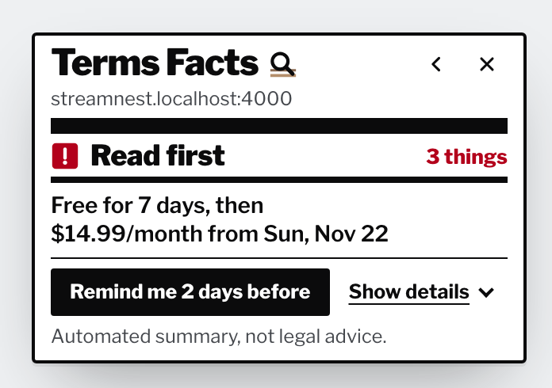
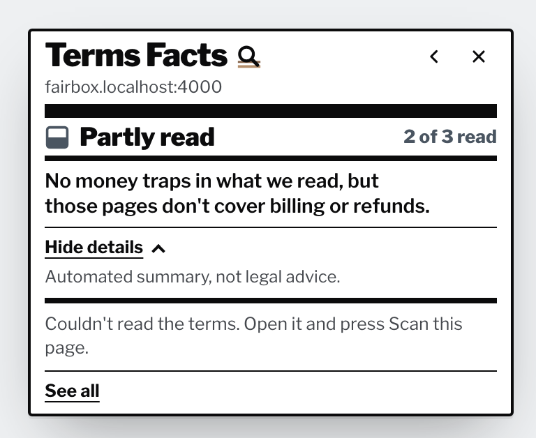
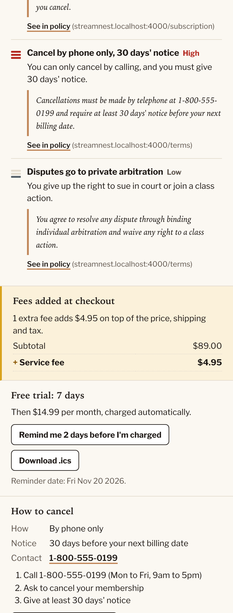
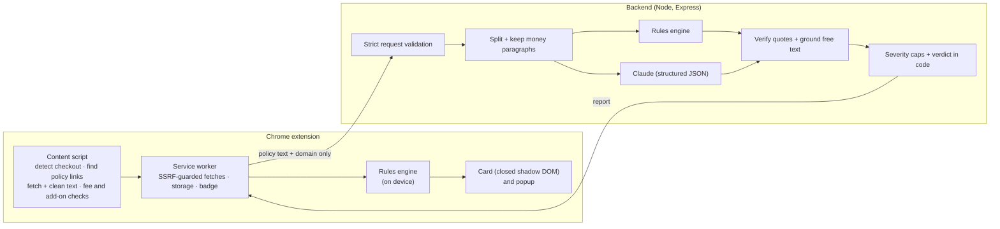
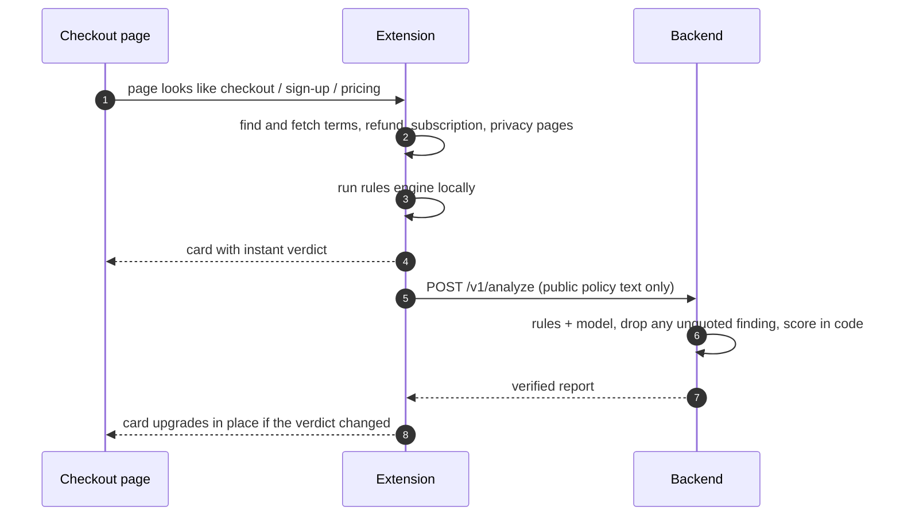

<div align="center">


# Xcavate

**Digs up the fine print before you pay.**

The terms checker that can't make up a warning: every warning it shows quotes the exact sentence it came from.


[What it does](#what-it-does) · [See it](#see-it) · [Quick start](#quick-start) · [How it works](#how-it-works) · [Privacy](#privacy-and-security) · [Contributing](#contributing)

</div>

> [!NOTE]
> Built for a hackathon with the theme "Let's dig in". Xcavate gives an automated summary of public policy text. **It is not legal advice.**

---

## Before you click, share or pay

Online, a single click can mean more than you intended: a free trial becomes a monthly charge, an extra fee raises your total, or ‘I agree’ gives permission to share your data. And sometimes, the website itself isn’t trustworthy.

The information you need is often scattered across checkout screens, privacy policies, and pages of terms, right when you’re trying to make a simple decision.

**Xcavate is a browser companion that brings those risks into view before you click, share, or pay.** It highlights fees and subscription commitments, explains important policy terms with exact supporting quotes, and helps you act with reminders and cancellation guidance. We’re also building site-reputation and phishing checks into that same experience.

The scale is real. In 2025, the FBI recorded **$215.8 million in reported phishing and spoofing losses**, and **$503.4 million in non-payment/non-delivery losses** (a category covering buyers not receiving purchases and sellers not receiving payment). Separately, a 2024 global privacy sweep found deceptive design that could influence people to share more personal information in **97% of more than 1,000 websites and apps reviewed**. That percentage describes the reviewed sample, not every website. Sources: [FBI IC3, pages 7–8](https://www.ic3.gov/AnnualReport/Reports/2025_IC3Report.pdf), [GPEN privacy sweep](https://www.priv.gc.ca/en/opc-news/news-and-announcements/2024/nr-c_240709/).

In the current build, privacy findings appear in the full report while the checkout verdict focuses on money risks. Site-reputation checks and phishing warnings are still being built and are not demonstrated by this version. The external figures describe the problem’s scale, not measured losses prevented by Xcavate.


## What it does

When you land on a checkout, sign-up or pricing page, Xcavate finds the site's terms, refund, subscription and privacy pages, reads them, and puts a small card in the corner of the page with a verdict and up to three warnings about things that can cost you money.

<table>
<tr>
<td width="33%" valign="top">

### 🔍 Proof, not vibes
Each warning shows the exact sentence from the policy. **See in policy** opens the page with that sentence highlighted. A quote that isn't in the text never reaches you.

</td>
<td width="33%" valign="top">

### 📅 Action, not just a grade
A free trial becomes a dated headline: *"Free for 7 days, then $14.99/month from Sat, Nov 21"*, with a one-click reminder (Google Calendar or `.ics`) and a cancellation helper.

</td>
<td width="33%" valign="top">

### 🛡️ Private and hands-off
Fee and add-on checks run inside the page. Form contents are never read. The extension never clicks, fills, submits or blocks anything.

</td>
</tr>
</table>

| Feature | What you see |
|---|---|
| **Verdict** | `!` Read first · `~` Worth a look · `✓` Looks fair · `◐` Partly read · `?` Couldn't read. Every verdict has an icon and a word, not only a colour. |
| **Money-first warnings** | Auto-renewal, trial converts to paid, hard to cancel, early termination fee, limited refunds, return costs, price changes, extra fees. Arbitration and data sharing are listed in the full report but never drive the verdict. |
| **Context lines** | *"Common for streaming services. What matters is how you cancel."* A plain renewal with online cancellation is not treated as a trap. |
| **Hidden fees and pre-checked add-ons** | "Service fee $4.95" in the order summary, or a protection plan ticked for you, is pointed out. Xcavate never unticks it. |
| **Who's watching this checkout** | Session recorders (Hotjar, FullStory, Clarity...) and ad pixels (Meta, TikTok...) loaded on the page are named, next to what the privacy policy says about sharing. Found on your device from script addresses only; nothing is sent and nothing is blocked. |
| **Cancellation helper** | Method, steps, notice period and contact, plus an email draft you send yourself. |
| **Your rights note** | Phone-only cancellation for a subscription you can start online gets a short, sourced note about California law, worded as information. |
| **Instant on-device verdict** | The rules engine runs in the extension, so a verdict appears at once. The AI check upgrades it when the backend answers, and can be turned off entirely. |
| **Honest uncertainty** | If the terms or refund policy couldn't be read, or the pages read say nothing about billing or refunds, the verdict is **Partly read**, never a false green. If the AI check didn't run, the popup says so. |
| **AI as a checker, not an oracle** | Claude reviews each rules finding and can soften a misread one by one level, but only with a verified quote from the same clause. It can never erase a rules finding, and on a site whose terms try to instruct AI tools it can't soften anything. |
| **Stays out of the way** | The card opens compact (verdict and one line, about 110 px tall), expands on demand, and can be moved to the other corner. |

## See it

<table>
<tr>
<td align="center" valign="top" width="50%">

<br><sub><b>The card at checkout, details expanded.</b> Trial charge date up front, the quoted sentence, a reminder button.</sub>
<br><br>

<br><sub><b>Partly read.</b> When key pages can't be fetched, Xcavate says so instead of showing green.</sub>
</td>
<td align="center" valign="top" width="50%">

<br><sub><b>The full report.</b> Every warning with its severity, cost and quote.</sub>
</td>
</tr>
</table>

<sub>Screenshots from the fictional StreamNest demo store, which also loads hostile CSS to prove the card can't be restyled.</sub>

## How it compares

Several tools already put an AI grade on terms of service. Xcavate competes on proof and on action at the moment you pay.

| | Community graders (ToS;DR) | AI term summarisers (TermAlert, AgreeGuard, TermsDigest) | General AI in the browser (Gemini in Chrome) | **Xcavate** |
|---|---|---|---|---|
| Coverage | Sites already reviewed | Any site | Any page you ask about | Any site, automatically at checkout |
| Focus | Rights and privacy | Broad risk summary | Whatever you ask | **What can cost you money** |
| Proof | Curated points | Model summary | Model answer | **Verified verbatim quote, highlighted in the policy** |
| Can it invent a warning? | No (human-curated) | Possible | Possible | **No: unquoted findings are dropped** |
| Unreadable terms | n/a | Varies | Varies | **Partly read, never green** |
| Action | None | Mostly none | You ask for it | **Charge-date reminder, cancellation helper** |

<sub>Based on public product descriptions as of November 2026. ToS;DR does valuable, careful work; Xcavate answers a narrower question at a different moment.</sub>

## Judge demo room

After `npm install`, run `npm run demo` and open **http://localhost:4000/**. This builds the extension and starts both local services in rules-only mock mode. The demo room has a seven-beat presentation, a timer, source quotes, live-store launchers and a 14-case rehearsal checklist. Starting the presentation restores StreamNest terms to v1 so the spoken price matches the policy. Ctrl+C stops both services.

Load `extension/dist` once in Chrome. The demo room opens actual fixture stores in a separate tab; its expected-outcome labels and manually checked boxes are not extension results or accuracy claims. The original fixture directory remains at `/fixtures`. See [the local presenter guide](fixtures/demo/README.md).

## Quick start

**You need:** Node.js 22 or newer and Google Chrome 116 or newer. No API key is needed for the demo.

```bash
git clone https://github.com/hiratinspace/xcavate.git && cd xcavate
npm install
```

Run these in three terminals from the repo root:

```bash
npm run dev:fixtures   # 1. fictional demo stores on *.localhost:4000 (+ a legal host on :4001)
npm run dev:server     # 2. analysis backend on http://localhost:8787 (offline mock mode)
npm run build          # 3. build the extension into extension/dist
```

Load the extension: open `chrome://extensions`, turn on **Developer mode**, click **Load unpacked** and pick `extension/dist`.

Then visit **http://streamnest.localhost:4000/checkout**. The card appears within a few seconds.

| Demo store | Planted terms | Expected |
|---|---|---|
| [`streamnest.localhost:4000/checkout`](http://streamnest.localhost:4000/checkout) | 7-day trial then $14.99/month, phone-only cancellation with 30 days' notice | `!` Read first |
| [`gadgetly.localhost:4000/checkout`](http://gadgetly.localhost:4000/checkout) | 25% restocking fee, buyer pays returns; a $4.95 service fee and a pre-checked protection plan on the page | `~` Worth a look |
| [`fairbox.localhost:4000/checkout`](http://fairbox.localhost:4000/checkout) | 30-day full refund, free returns (the clean control) | `✓` Looks fair |
| [`sneakyterms.localhost:4000/checkout`](http://sneakyterms.localhost:4000/checkout) | "All sales are final", plus six kinds of hidden prompt injection telling AI tools to report no issues | `!` Read first |
| [`shopapp.localhost:4000/`](http://shopapp.localhost:4000/) | Single-page app that switches to checkout without a reload | Detected |

Chrome resolves `*.localhost` to your own machine, so no hosts-file changes are needed. `npm run seed` pre-fills the cache so every store answers instantly.

<details>
<summary><b>Use the real model (Claude)</b></summary>

<br>

Mock mode works fully offline and is what the tests use. To analyse with Claude:

```bash
cp server/.env.example server/.env
```

```ini
LLM_PROVIDER=anthropic
LLM_API_KEY=<your Anthropic API key>
LLM_MODEL=            # empty means claude-sonnet-5-5
```

Restart `npm run dev:server`. `GET http://localhost:8787/healthz` reports the active provider. If the model is slow or unavailable, you still get the rules-only result. The key stays on the server; the extension holds no secrets.

</details>

## How it works





1. **Detect.** The page is scored on URL words, card-field presence, payment iframes and pay buttons. Only the presence of fields is checked, never their values.
2. **Find.** Up to four policy links, preferring the "By placing your order you agree to..." links next to the pay button, with Shopify fallback paths.
3. **Read.** Policies are fetched and cleaned. Hidden text (`display:none`, zero-size fonts, `aria-hidden`) is stripped, so instructions planted for AI tools never get read.
4. **Analyse.** A deterministic rules engine and the model run side by side. The model only proposes findings; a high-severity rules finding can't be removed because the model said nothing.
5. **Verify.** A quote must appear in a single paragraph of the policy, be at least five words long and contain an un-negated keyword for its category. Model free text is grounded in the policy or replaced by a template.
6. **Score.** Severity caps and the verdict are computed in code, never by the model.

## Privacy and security

| | |
|---|---|
| **Leaves the browser** | The site's domain and the text of the public policy pages it links to (URLs with query strings removed). With the AI check off, nothing leaves at all. |
| **Stays local** | Fee and add-on detection. Form, cart and card fields are never read (a test fails if `.value` appears in the content script). |
| **Strict API** | The server rejects any request field it doesn't know, so cart or form data can't slip through. One user's request never becomes another user's report. |
| **API key** | Lives only in `server/.env` on the backend. |
| **Prompt injection** | Hidden text stripped, policy framed as untrusted data with every `<` escaped, schema-checked JSON output, verdict computed in code. The SneakyTerms store tests six injection variants. |
| **SSRF guard** | A shop page can't make the extension fetch loopback, private, link-local or `.local` addresses, including disguised IP spellings. |
| **Page safety** | The card lives in a closed shadow root: page styles can't break it and it can't break the page. |
| **Server hygiene** | Per-IP rate limit, size caps, a fixed prompt, logs that record domain and timing only. |

## Accuracy, honestly

Measured on 2026-11-15 over 5 demo stores and 10 real-world policies from well-known streaming, subscription, retail and gym sites (texts kept locally, not in the repo). Model runs were repeated 3 times; results did not vary.

| | Rules only (on device) | **Rules + Claude Sonnet 5.5** (default) |
|---|---|---|
| Demo store verdicts | 5 / 5 | **5 / 5** |
| Real-world flag precision | 95% | **91%** |
| Real-world flag recall | 100% | **100%** |
| Severity agrees with label | 75% | **75%** |
| Real-world verdicts matching the draft labels | 6 / 10 | **6 / 10** |
| Model findings dropped by quote check | n/a | 31% |
| Analysis time p50 / p90 | instant | 2.7 s / 8.8 s |

**Why verdicts read 6 / 10.** All four disagreements are deliberate calls where the draft labels predate the current rubric: a "no refund for a partly used month" clause is now treated as normal for subscriptions (two streaming services move from red to yellow), a restocking fee that only applies to non-compliant returns at a free-returns store is low (yellow to green), and a generic terms page with no billing terms is **Partly read** instead of green. The labels are waiting for human review rather than being edited to match the system.

Earlier model comparison on the previous rules version: Sonnet 5.5 beat Haiku 5.5 and Opus 5.5 on precision and speed, which is why it is the default.

> [!IMPORTANT]
> Small sample, provisional labels. The labels were drafted by an AI agent and haven't been human-reviewed, and the rules were developed while looking at these texts, so these are not held-out results. Run `npm run eval -- --compare --runs 3` to reproduce.

## Project layout

```
packages/shared/      contracts: zod schemas, types, categories, verdict wording
  src/engine/         rules engine and analysis steps, shared by server and extension
extension/            Manifest V3 extension (TypeScript, esbuild)
  src/content/        page classifier, policy finder, extractor, fees, add-ons, card
  src/background/     service worker: storage, guarded fetches, backend calls, badge
  src/lib/            network guard, capped fetch, calendar/.ics/mailto, money parsing
  src/popup/          full report, trial reminder, cancellation helper, settings
server/               Express backend: routes, pipeline orchestration, LLM client, store
fixtures/             fictional demo stores, fixture server, golden verdicts
eval/                 accuracy script (precision, recall, verdicts, latency)
AGENTS.md             architecture, rules and status for contributors (start here)
```

## Scripts

| Command | What it does |
|---|---|
| `npm run dev:fixtures` | Serves the demo stores on `*.localhost:4000` and `legal.localhost:4001` |
| `npm run dev:server` | Starts the backend on port 8787 with reload on change |
| `npm run build` | Builds shared, server and the extension (`extension/dist`) |
| `npm run dev:ext` | Rebuilds the extension on change |
| `npm test` | Runs every unit and integration test (vitest, no network, no API key) |
| `npm run e2e` | Loads the built extension in real Chromium and checks every demo store end to end (Playwright) |
| `npm run typecheck` | Type-checks every package |
| `npm run seed` | Pre-analyses every demo store into the local cache |
| `npm run eval` | Precision and recall per category, verdict accuracy, latency |

## Limitations

- Chrome only; no Firefox, Safari or mobile.
- English only; PDF policies aren't read.
- Policies behind a login, bot protection or heavy JavaScript need the **Scan this page** fallback.
- The extension asks for access to all sites because it must run on any shop and fetch policy pages on other domains. A store release would narrow this to per-site permission.

## Contributing

Read [`AGENTS.md`](AGENTS.md) first: it covers the architecture, the lanes, the done-checks (`npm test`, `npm run typecheck`, extension build, golden verdicts), the privacy rules and the open tasks. The manual end-to-end checklist is in [`extension/SMOKE_TEST.md`](extension/SMOKE_TEST.md), and the demo store contract is in [`fixtures/README.md`](fixtures/README.md).

## Disclaimer

Xcavate gives an automated summary of public policy text to help you decide what's worth reading before you pay. It can miss things, and a warning is not a claim that a company has done anything wrong. The demo stores are fictional.

<div align="center">

**Automated summary, not legal advice.**

</div>
